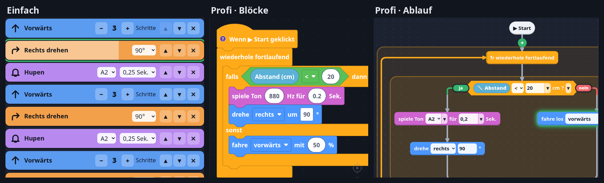

# mbot-flow

Self-hosted block and flowchart programming for the classic Makeblock **mBot** (mCore board), made for kids.
A small server on your PC serves a German web GUI. Programs are compiled to bytecode and run **on the robot
itself** by a custom firmware, so it reacts to its sensors instantly, however slow the link is.



```
 browser (tablet, PC)  ──HTTP──►  server (PC)  ──USB / WiFi / BLE──►  mBot: bytecode VM firmware
                       ◄── live ──             ◄──── telemetry ─────
```

## What it gives you

- **Two levels.** *Einfach*: big blocks in a list (forward, turn, wait, honk) for kids who can't read much
  yet. *Profi*: loops, conditions, sensors, variables and own blocks with inputs.
- **Blocks or flowchart.** A Profi program is shown either as Scratch-like blocks or as a flowchart that lays
  itself out, with forks, loops, drag and drop and touch. Switch any time; it's the same program.
- **Runs on the robot.** "Drive until the line is lost" reacts within microseconds, not a WiFi round trip. The
  page shows live which block is running and what the sensors see.
- **Programs as blocks.** Every saved program becomes a block that other programs can use.
- **Remote control.** Arrow keys, on-screen pad or a game controller; the robot stops by itself if the link
  dies.
- **Calibration.** A guided dialog makes "1 step" and "90°" true for your robot (the mBot has no encoders).
- **Works without the robot.** A simulator with a line to follow and walls.
- **No cloud, no account.** Python standard library plus `pyserial`/`bleak`; the GUI is plain HTML/JS and
  works offline.

## Getting started

You need an mBot (mCore), a USB cable, Linux (or macOS, untested) with [uv](https://docs.astral.sh/uv/), and a
browser.

```sh
tools/setup.sh                 # project-local Arduino toolchain (~450 MB, inside tools/)
./flash.sh /dev/ttyUSB0        # pull the Bluetooth module first – see docs/flashing.md
./start.sh                     # then open http://localhost:8000
```

Then run **⚙ Kalibrierung** once with the robot on the floor.

| | |
|---|---|
| [docs/flashing.md](docs/flashing.md) | toolchain, flashing, backing up and restoring Makeblock's firmware |
| [docs/usage.md](docs/usage.md) | connecting (USB, WiFi, BLE, simulator), calibration, the modes, remote control |
| [docs/architecture.md](docs/architecture.md) | how it works: server, compiler, data, HTTP API, development |
| [docs/vm.md](docs/vm.md) | the VM firmware: instruction set and wire protocol |
| [pico_bridge/wiring.html](pico_bridge/wiring.html) | a Raspberry Pi Pico W as WiFi bridge in the Bluetooth module's socket |

## Limitations

- The GUI is German only.
- Flashing needs the Bluetooth module unplugged; over-the-air flashing isn't possible
  ([why](docs/flashing.md#no-flashing-over-bluetooth)).
- BLE is implemented but not tested with this firmware yet; USB and the Pico W bridge are.
- Distances and turns are timed, so they drift as the batteries run down.
- No login: open it to the network (`--host 0.0.0.0`) only on a network you trust.
- Unused so far: the onboard RGB LEDs, the IR receiver, storing a program on the robot to run without a PC.

## Credits

- **[Blockly](https://github.com/google/blockly)** and
  **[@blockly/continuous-toolbox](https://github.com/google/blockly-samples)** by Google (Apache-2.0),
  vendored in `web/vendor/blockly/`.
- **[Makeblock-Libraries](https://github.com/Makeblock-official/Makeblock-Libraries)** – the pin map in
  `MeMCore.h`, and the original firmware in [`factory/`](factory/README.md) (CC BY-SA 3.0).
- **[mCore schematic](https://github.com/Makeblock-official/mBot/blob/master/pcb/mCore.pdf)** – why flashing
  needs the Bluetooth module out.

Makeblock, mBot and mBlock are trademarks of Makeblock Co., Ltd. This project is not affiliated with or
endorsed by Makeblock, and comes with no warranty. Flashing replaces the robot's firmware; it can be restored
as described in [docs/flashing.md](docs/flashing.md#getting-the-original-firmware-back).

## Written by an AI

The code, tests and docs were written with [Claude Code](https://claude.com/claude-code),
directed and tested on real hardware by a human. It runs well, but nobody has audited it line by line.

## License

MIT, see [LICENSE](LICENSE). Third-party parts keep their own licenses: Blockly (Apache-2.0), Makeblock's
firmware in `factory/` (CC BY-SA 3.0).
