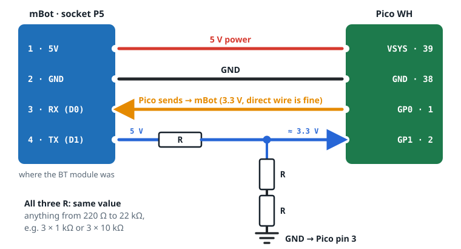
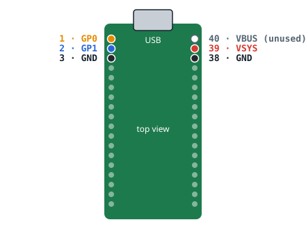

# Pico W WiFi bridge

A Raspberry Pi Pico W(H) in the Bluetooth module's socket joins your WiFi and passes the robot's serial line to the
server. Four wires, three resistors, MicroPython code in [`pico_bridge/`](../pico_bridge/).

## Wiring



The robot's TX is 5 V; the Pico's pins are not 5 V tolerant. One resistor on top and two below divide it to ⅔ (≈ 3.3 V).
All three resistors have the same value, anything from 220 Ω to 22 kΩ.

| Wire | mBot socket P5 | Pico | Notes |
|---|---|---|---|
| Power | pin 1 · 5V | pin 39 · VSYS | VSYS takes 1.8–5.5 V |
| Ground | pin 2 · GND | pin 38 · GND | |
| Pico → mBot | pin 3 · RX (D0) | pin 1 · GP0 | direct; pull this one to flash over USB |
| mBot → Pico | pin 4 · TX (D1) | pin 2 · GP1 | through one R, plus two R from GP1 to GND |
| Divider ground | – | pin 3 · GND | bottom of the two lower R |



Pico: USB plug up, chip side facing you; all pins are in the top three rows (names are printed on the back).
mBot: pin numbers are from the [mCore schematic](https://github.com/Makeblock-official/mBot/blob/master/pcb/mCore.pdf);
with the robot on and the socket empty, pin 1 measures 5 V against pin 2.

## Setup

```sh
./pico_bridge/upload.sh /dev/ttyACM0   # Pico (MicroPython) on USB, not wired to the robot
```

The first run creates `pico_bridge/wifi_config.py` (not in git); enter your WiFi name and password, run it again.

1. Flash the mBot firmware first, over USB with the socket empty ([flashing.md](flashing.md)).
2. Robot off, Pico unplugged from USB, wire it up.
3. Robot on. Pico LED: fast blink = joining WiFi, slow blink = waiting for the server, steady = connected.
4. `./start.sh`, then in the GUI: **Not connected → Via WiFi (Pico) → Search → Connect**.

The server finds the Pico with a UDP broadcast (`MBOT?`, port 2324) and talks TCP on port 2323.

## Rules

- Never connect P5 pin 4 (mBot TX) straight to the Pico.
- Keep the Pico's USB unplugged while it is wired to the robot, or the PC's USB power flows into the robot.
- Before flashing the mBot over USB, pull the wire on P5 pin 3; otherwise the upload gets garbled.
